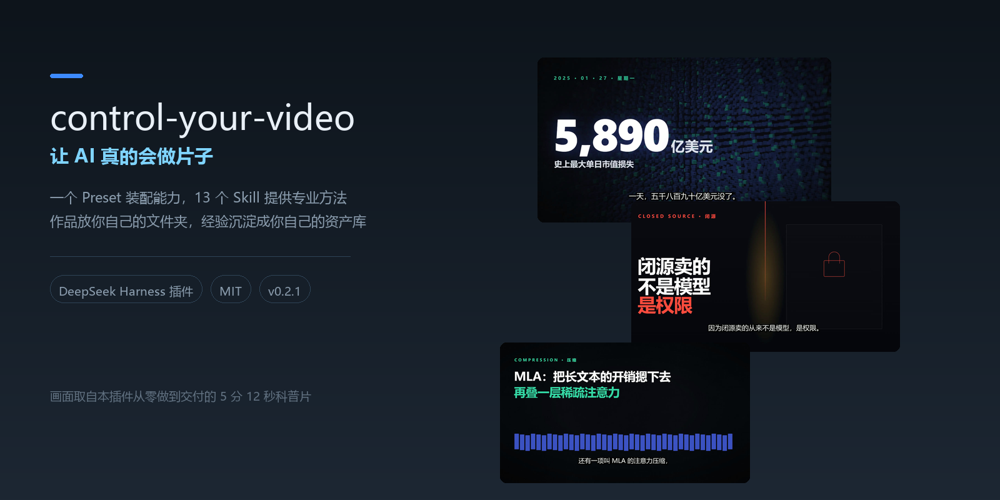

<p align="center">
  
</p>

<p align="center"><sub>Cover art is composed from stills of a film delivered with an earlier build, kept as an example; it is not a screenshot of this version.</sub></p>

<h1 align="center">Control Your Video</h1>
<p align="center">A DeepSeek Harness plugin that turns an idea, a script or your own footage into a finished video — with your decision at three checkpoints.</p>
<p align="center"><a href="README.zh.md">中文</a></p>

<p align="center">
  <a href="https://nodejs.org"></a>
  <a href="https://ffmpeg.org"></a>
  <a href="https://github.com/deepseek-ai"></a>
  <a href="https://opensource.org/license/mit"></a>
  <a href="https://github.com/HaoyanZhang123/dsh-plugin-control-your-video/releases/tag/v0.4.0"></a>
</p>

## Overview

`control-your-video` adds a **视频创作** (Video Creation) preset to DeepSeek Harness, plus a `cyv` tool that carries a video project from first idea to delivered file. You decide the creative direction, approve one complete shot-by-shot plan, watch a representative sample, and accept it before the full video is rendered. Every revision is delivered as a complete new file while the old one stays where it was.

This is a plugin bundle, not a timeline editor. It does not ship footage, fonts, music, models or a render farm. The local route runs on the `ffmpeg` and `ffprobe` already on your machine; the thirteen method skills tell the assistant how to plan, write, frame, cut, mix, review and deliver a video.

## Features

- **Three checkpoints, recorded by the Host.** The creative direction, the complete plan version and the representative sample are each confirmed through DSH's user-question service. The answer is stored by the Host and bound to content: a plan approval carries the `plan.md` digest, the production recipe and the chosen sample shots; a sample approval carries the sample file's SHA-256. Editing the plan or approving another version invalidates the old approval.
- **A complete plan before production.** `plan-check` reads `plan.md` and reports missing shots, per-shot and total duration mismatches, and assets it cannot verify. It accepts a shot table or per-shot subsections, and treats "not made yet but with a stated path" differently from "genuinely missing".
- **A local FFmpeg route.** Procedural graphics (four generated patterns), photos already in the project, or existing video as the picture; captions from a system font; audio as silence, a generated tone, a supplied track or a shot's own sound. It renders a representative sample, a full video and complete revisions, validating the recipe first and holding a per-project lock.
- **Project folders and copied media.** A project is an ordinary folder in your workspace. Imported media is copied into `assets/` with hashes and the original stays untouched; when a name clashes the later file is renamed and both are kept. Unsafe paths and symbolic links are refused.
- **An optional experience library.** It lives at `<workspace>/control-your-video/`, is not created until you ask for it, is organised by use case, and is only read or written after you agree.
- **Thirteen method skills with 49 on-demand references.** Planning, script, visuals, motion, prompting, code-rendered frames, editing, sound, review, delivery, the library and skill authoring. Bodies stay short and load a reference only when a task needs it.
- **A separate preset for fact-checking public material.** It does web search and page reading, file viewing, todos and questions, and leaves creative and production work to the main session.

## Installation

Requirements:

- **DeepSeek Harness** — the host application. This is a plugin bundle, not a standalone program.
- **Node.js 22.3 or later** — the preset resolves its skill directory through `process.getBuiltinModule`. DSH Desktop ships a compatible runtime.
- **FFmpeg and FFprobe on the Host path**, with the H.264 and AAC encoders — needed by the local production route.
- **A system font** for captions.

Install:

1. In DSH's plugin manager, choose **install from a local directory** and point it at this package's root, or install the packaged archive `dsh-plugin-control-your-video-0.4.0.tgz` from the [v0.4.0 release](https://github.com/HaoyanZhang123/dsh-plugin-control-your-video/releases/tag/v0.4.0).
2. **Restart DSH** when it prompts you. Bundle and preset changes only take effect after a restart.
3. **Open a new session** and select **视频创作** (Video Creation). Preset changes never apply to sessions that are already open.
4. Optional check: ask the assistant to run `cyv` with `local_capabilities`; it reports the `ffmpeg` and `ffprobe` versions and encoder availability it can actually see.

Editing a skill's markdown takes effect immediately, because skills are read from the package directory at runtime. Only `cordis.patch.yml` changes need a reinstall and restart.

## Usage

Say what you want in plain language. A one-line idea, a script, a folder of footage, or "the part at 0:40 drags" are all valid openings.

1. The assistant proposes a small number of genuinely different directions and states what it recommends.
2. You confirm the creative direction. A complete `plan.md` follows, with every shot's picture, motion, duration, sound and production path.
3. You approve that plan version. The assistant renders a representative sample — a real file, not a description — and stops.
4. You watch the sample and either ask for changes on specific shots or accept it.
5. Accepted: the full video is rendered and delivered. Not accepted: corrections go back through the sample.

A revision ("make the last caption shorter") produces a complete new video next to the old one. A standalone caption task on an existing clip has its own entry and does not need the three checkpoints.

The acceptance script lives in the [user acceptance guide (Chinese)](docs/验证指南.md).

## Project files and the experience library

```
<workspace>/my-film/            ← project: an ordinary folder you name
  plan.md                       ← the complete plan you approved
  assets/                       ← copies of the media you supplied
  output/                       ← sample, full video, revisions
  work/                         ← project metadata and evidence
```

Nothing is moved out of your folders and no format is locked. The experience library is a separate `control-your-video/` folder in the workspace, written only after delivery and only if you say yes.

## Approval boundaries

The three checkpoints are a **workflow constraint, not an unbypassable runtime gate.** The preset mounts the standard DSH tool list — shell, file access, background jobs, plan mode, subagents and workflows — so a local render can in principle be driven without going through `cyv`. What the checkpoints guarantee is that on the built-in `cyv` route, only a content version you approved continues; `tools/preset-policy.js` is a no-op and sets no plugin-wide gate. Separate DSH sessions, an OS shell outside DSH, and other installed Host plugins each have their own permissions.

Generation models are optional. A Host plugin can offer model providers; a standalone media task then needs separate approvals for the model and for a spending cap, and one approval covers exactly one call. The provider interface in this repository has not been connected to a real service.

## Verification and known limits

- `npm test` exercises plan validation, project creation and media import, approval binding, local production and the experience library. `tests/host-smoke.cjs` drives the whole flow through an installed DSH and a real FFmpeg: a representative sample, a full video, a complete revision beside the old one, a standalone caption job on imported footage with the original left intact, and a library save followed by an approved search.
- Verified on Windows 11 with DSH Desktop `0.2.2-rc.5`, Node 24.22.1 and FFmpeg/FFprobe 9.0.1. macOS, Linux and other Host versions have not been tested.
- The user completed a real minimal film on `0.4.0-rc.3` and reported that the core skills met the goal. That is a user report, not a recorded measurement: the film's title, technique and duration are not part of this repository.
- There is no A/B comparison against a plain prompt, no multi-genre or multi-person run, and no library-reuse test across a second film.
- `plan-check` judges completeness, duration and verifiable assets — not whether the plan is any good. A green report still needs your eyes and ears.

## Upgrade notes

`cordis.patch.yml` changed in this version, so a restart per the Host prompt and a new session are required. If you installed 0.3.0 through a link — `npm link`, a linked local directory, or a `file:` dependency pointing at an old path — repoint it at the 0.4.0 package or this package directory first; otherwise the restarted Host keeps loading the old build. Keeping the previous version's directory, your project folders and your experience library costs nothing and is what lets you roll back, so there is no reason to delete them.

## Documentation

- [Changelog](CHANGELOG.md)
- [Plugin detail (Chinese)](docs/DETAIL.md)
- [User acceptance guide (Chinese)](docs/验证指南.md)
- [Engineering acceptance record (Chinese)](docs/工程验收.md)
- [Plan and shot specification (Chinese)](docs/编写规范.md)

## License

The plugin source is [MIT](LICENSE). External tools and services keep their own terms.
