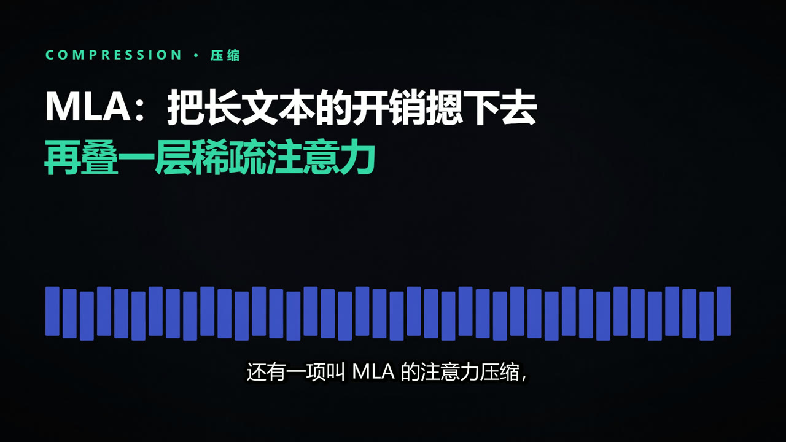
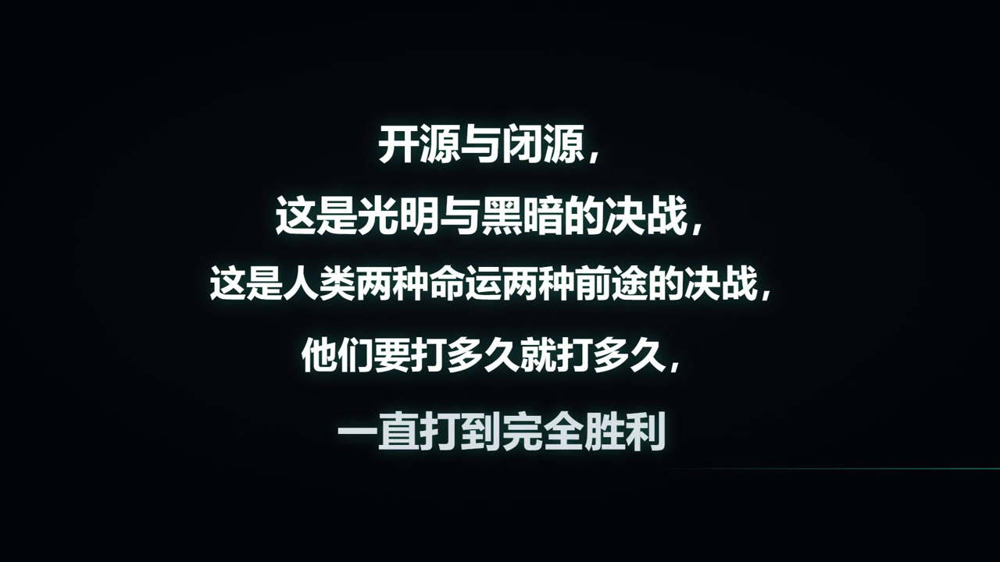

<p align="center">
  
</p>

<h1 align="center">control-your-video</h1>
<p align="center">A DeepSeek Harness plugin that lets the assistant actually make videos.</p>
<p align="center"><a href="README.zh.md">中文</a></p>

<p align="center">
  <a href="https://nodejs.org"></a>
  <a href="https://ffmpeg.org"></a>
  <a href="https://github.com/deepseek-ai"></a>
  <a href="https://opensource.org/license/mit"></a>
  <a href="https://github.com/HaoyanZhang123/dsh-plugin-control-your-video/releases"></a>
</p>

## Overview

`control-your-video` is a DeepSeek Harness (DSH) plugin bundle. It does not ship a timeline editor or a render farm. It ships **method**: one agent preset that assembles the tools a video project needs, and thirteen skills that tell the assistant how to plan, write, shoot, cut, mix, review and release a video like someone who has done it before.

Your footage, your project files and your accumulated experience stay in your own folders. The plugin never moves them, never locks a format and never uploads anything.

## Features

**Planning and writing**

- Turn a vague feeling ("make it hit harder") into a concrete plan: format, structure, duration budget, shot list.
- Strong boundaries between what the assistant decides and what only you can decide — aesthetic direction is yours.
- Rewrite an article into spoken narration; strip AI-flavoured phrasing.

**Making the picture**

- Decide whether a shot should be filmed, generated, or drawn with code.
- Prompt guides for current video models, with each model's control surface and failure modes.
- Code-rendered frames (HTML / Canvas / three.js) with a deterministic render pipeline and a frame-level acceptance check.

**Sound, edit and delivery**

- Choose between a human recording, TTS, existing voice-over, or no narration at all — then mix to a measured loudness target.
- Transitions, cutting rhythm, subtitle line-breaking and retiming.
- Review by evidence, not by memory: extract frames, measure black frames, loudness and silence, and keep an index of what was actually looked at.
- A delivery check that separates "technically valid", "rights are cleared" and "I think it looks good" into three different answers.

**Everything else**

- **1 preset** that wires up file access, shell, long-running jobs and on-demand skill loading.
- **13 skills**, each under 150 lines, with **48 on-demand references**. The body only says *when* to read which reference, so nothing bloats the context until it is needed.
- **1 `evidence` tool** wrapping `ffmpeg`/`ffprobe` for frame extraction and measurement. Optional — you can make a video without it, you just cannot prove what you looked at.


## Installation

Requirements:

- **DeepSeek Harness** — the host application. This is a DSH plugin bundle, not a standalone program.
- **Node.js 22.3 or later** — the preset resolves its skill directory through `process.getBuiltinModule`.
- **FFmpeg and FFprobe** *(optional)* — only the `evidence` tool needs them; everything else works without.

Install from a local directory:

1. In DSH's plugin manager, choose **install from local directory** and point it at this package's root directory.
2. **Restart DSH.** Bundle and preset changes only take effect after a restart.
3. **Open a new session** and select the **视频创作** (video creation) preset. Preset changes never apply to sessions that are already open.
4. Check the skill catalogue lists 13 names, from `video-intent` through `video-skill-authoring`.

After installation, editing a skill's markdown takes effect immediately — skills are read from the package directory at runtime. Only changes to `cordis.patch.yml` require reinstalling and restarting.

## Usage

Say what you want in plain language. A brief, a paragraph of copy, a folder of footage, a reference film, or "the part at 0:40 drags" — all valid openings.

The first round normally is not a finished video. You get three things:

1. **What it thinks you want** — your "make it feel expensive" translated into concrete picture, pacing and sound decisions, with the uncertain parts stated as uncertain.
2. **A plan** — format, structure, duration budget, and what each shot needs.
3. **A short sample** — when the project is worth testing on a small piece first.

It stops for you twice by default: after the overall plan, and after the sample. Everything between — sourcing, rendering, checking — it runs on its own, and you can interrupt at any point.


## Your Asset Library

This is what separates the plugin from a one-shot prompt: **finished work leaves something reusable behind.**

**On your first project the library is empty, and that is correct.** It is not a bundled reference collection; it grows out of your own films. When a project ends, the assistant picks out the practices that genuinely generalise and asks whether to record them. Only after you say yes does the first entry exist.

```
<workspace>/control-your-video/     ← cross-project experience, travels with the workspace
  index.md          one line per entry; the only way in when reading
  preferences.md    your aesthetic preferences and hard constraints
  methods/          method cards: under which format, what happens, when it stops working
  prompts/          recipes measured on this machine, with version and failure conditions
  references/       break-downs of reference films: what was borrowed, what was not
  templates/        reusable section structures
  lessons.md        traps hit, and how to recognise them again
```

Project files — plans, footage, renders, evidence — stay out of the library, in your own project folder. The library only takes what still holds for a different film.

- What is worth recording, and how to judge whether an entry qualifies: the `video-library` skill.
- Field definitions and the single-line `index.md` format: `docs/编写规范.md` §1.4.

**Can you use someone else's library?** Yes. It is a handful of Markdown files. But every entry carries its own applicability and failure conditions, so read those two lines before copying. Sharing your own library is equally fine — those are your files, under whatever licence you choose.

## Project Structure

```
skills/     13 skill directories, each with SKILL.md and its own references/
tools/      evidence.js — frame extraction and measurement, runnable by hand
docs/       编写规范.md (the five shared contracts), DETAIL.md (plugin page copy)
locale/     plugin-manager strings, Chinese and English
assets/     cover and real stills used by the READMEs
index.js    thin DSH tool wrapper around tools/evidence.js
```

The five shared contracts — shot spec, intent brief, revision brief, library entry, evidence index — are defined in exactly one place, `docs/编写规范.md`. Skills reference them and never restate them.

## Limitations

Read this before trusting anything.

- **Tested end to end once.** One 5 min 12 s science-explainer video was taken from zero to delivery. **The full path has never been run twice with a library to reuse.**
- **No A/B comparison.** There is no evidence that this plugin beats a plain prompt. It has not been measured.
- **Not watched or listened to.** That run had no audio playback and no continuous playback channel, so every impression was inferred from measurement and extracted frames. Nobody sat and watched it straight through.
- **No library reuse ever exercised.** A library was produced exactly once (7 categories, 8 files). A second film that reads it has never happened.
- **Generation models untested.** The prompting skill was loaded and judged "not applicable" on that project; no real generation was run.
- **Remotion and Canva untested.**
- **`gc` untested.** The evidence tool's garbage-collection action has never run on a real project.
- **Platform AI labelling and fact-checking are out of scope.** Both remain the user's call.





## Notice on Source Paths

Skills cite provenance in paths like `resources/research/…`. Those point to the author's research library:

- The material is **not distributed** with this package and normally does not exist on your machine.
- Full paths are written so that anyone holding the material can trace it, not as a runtime promise.
- When the files are absent, follow the method in the skill body and its `references/` — the plugin works without them.

## License

[MIT](LICENSE).

**What ships in this package** is method and code written for this plugin, free to use, modify and redistribute. **External tools** (FFmpeg, Blender, a browser, TTS services) are installed by you and governed by their own terms; being called by this plugin does not relicense them. **Your films and your asset library** are yours and do not change ownership because you used this plugin.
