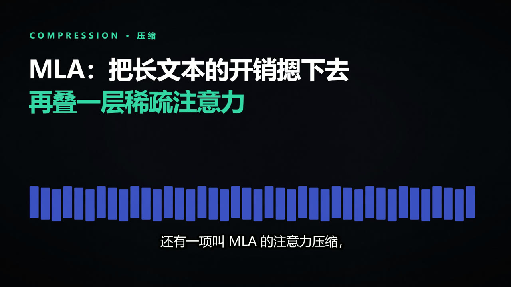
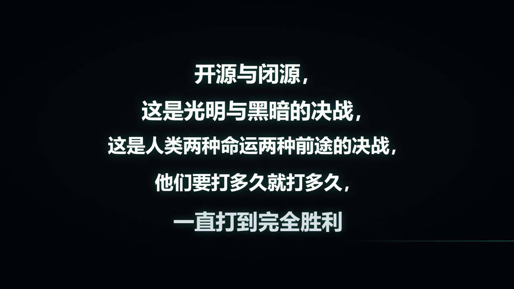

<p align="center">
  
</p>

<h1 align="center">control-your-video</h1>
<p align="center">一个让 DeepSeek Harness 里的助手真的会做片子的插件。</p>
<p align="center"><a href="README.md">English</a></p>

<p align="center">
  <a href="https://nodejs.org"></a>
  <a href="https://ffmpeg.org"></a>
  <a href="https://github.com/deepseek-ai"></a>
  <a href="https://opensource.org/license/mit"></a>
  <a href="https://github.com/HaoyanZhang123/dsh-plugin-control-your-video/releases"></a>
</p>

## 简介

`control-your-video` 是一个 DeepSeek Harness（DSH）插件包。它不带时间线编辑器，也不带渲染农场。它带的是**方法**：一个装配好视频项目所需工具的 agent Preset，和十三个告诉助手怎样像一个做过片子的人那样去规划、写、拍、剪、混、审、交付的 Skill。

你的素材、工程文件和积累下来的经验都留在你自己的文件夹里。插件不搬动它们、不锁定格式、也不上传任何东西。

## 核心特性

**规划与本子**

- 把一句说不清的感觉（"再燃一点"）变成具体方案：片型、结构、时长预算、镜头表。
- 助手替你决定的，和只有你能决定的，边界清楚——审美方向归你。
- 把一篇文章改成口播；清掉 AI 味。

**画面**

- 判断一个镜头该实拍、该生成、还是该用代码画。
- 当前视频模型的提示词指南，写清每个模型的控制面和失效点。
- 代码出帧（HTML / Canvas / three.js），配确定性渲染管线与逐帧验收。

**声音、剪辑与交付**

- 在真人录音、TTS、已有配音、无人声之间选，再混到实测的响度目标。
- 转场、剪辑节奏、字幕断行与重定时。
- 按证据审片，不凭记忆：抽帧、测黑帧、测响度与静音，留下"到底看过什么"的证据索引。
- 一道交付检查，把"技术合格""权利清楚""我觉得好看"拆成三个不同的答案。

**其余**

- **1 个 Preset**：挂好文件读写、命令执行、长任务与按需加载技能。
- **13 个 Skill**，每份正文不超过 150 行，配 **48 份按需参考**。正文只写*什么时候*去读哪一份，不读到就不占上下文。
- **1 个 `evidence` 工具**：封装 `ffmpeg`／`ffprobe` 做抽帧与测量。选装——没有它照样能做片，只是没法证明你看过什么。


## 安装

前置条件：

- **DeepSeek Harness**：宿主应用。这是 DSH 的插件包，不是独立程序。
- **Node.js 22.3 或更高**：Preset 通过 `process.getBuiltinModule` 解析技能目录。
- **FFmpeg 与 FFprobe**（*可选*）：只有 `evidence` 工具需要；其余功能不依赖。

从本地目录安装：

1. 在 DSH 的插件管理里选 **从本地目录安装**，指向本包根目录。
2. **重启 DSH**。bundle 与 Preset 的改动只在重启后生效。
3. **新开一个会话**，Preset 选 **视频创作**。Preset 变更不会应用到已经开着的会话。
4. 检查技能目录里出现 13 个名字，从 `video-intent` 到 `video-skill-authoring`。

装完之后改技能正文即时生效——技能在运行时从包目录读取。只有改 `cordis.patch.yml` 才需要重装并重启。

## 使用方式

直接说人话。一段想法、一段文案、一个装着素材的文件夹、一支参考片，或者"第 40 秒太拖了"——都可以是开场。

第一轮通常不是成片，你会拿到三样东西：

1. **它理解成什么样**——把你说的"要有质感"翻成具体的画面、节奏与声音判断，不确定的地方会明说不确定。
2. **一个方案**——片型、结构、时长预算，以及每一镜要什么。
3. **一段小样**——当这支片值得先做一小段看效果时。

它默认只在两处停下来：整体方案之后、小样之后。中间找素材、渲染、检查都由它自己推进，你随时可以插话。


## 你的资产库

这是本插件和"一次性提示词"最大的区别：**做完的片子会留下能复用的东西**。

**第一支片时库是空的，这是对的。** 它不是随包的资料集，而是从你自己的片子里长出来的。一支片结束时，助手会挑出真正能推广到别的片的做法，问你记不记；你说记，才有第一条。

```
<工作区>/control-your-video/     ← 跨作品的经验，跟着工作区走
  index.md          一行一条的入口，读库只从这里进
  preferences.md    你的审美偏好与硬约束
  methods/          方法卡：什么片型下、这样做会怎样、什么时候失效
  prompts/          本机实测出的配方，带版本与失效条件
  references/       参考片拆解：借了什么、不搬什么
  templates/        可复用的段落结构
  lessons.md        踩过的坑与识别特征
```

作品文件——方案、素材、成片、证据——不进库，放在你自己的作品文件夹。库只收"换一支片还成立"的东西。

- 什么值得记、一条记录够不够格：`video-library` 技能。
- 字段定义与 `index.md` 单行格式：`docs/编写规范.md` §1.4。

**能直接用别人分享的库吗？** 能。它就是一叠 Markdown 文件。但每条都带着自己的适用条件与失效条件，照抄前先读那两句。分享你自己的库也一样没问题——那是你的文件，用你选的许可。

## 项目结构

```
skills/     13 个技能目录，每个含 SKILL.md 与其专属 references/
tools/      evidence.js —— 抽帧与测量，也能人手直跑
docs/       编写规范.md（五个共享契约）、DETAIL.md（插件详情页文案）
locale/     插件管理器的中英文案
assets/     README 用的封面与真实成片静帧
index.js    DSH 工具薄壳，包住 tools/evidence.js
```

五个共享契约——镜头规格、意图摘要、修改单、库条目、证据索引——只在一处定义：`docs/编写规范.md`。各技能引用它，从不复述。

## 已知限制

信任何结论之前先读这一节。

- **只跑通过一次完整流程。** 一支 5 分 12 秒的科普片从零做到交付。**从没跑过第二次、带着可复用的库。**
- **没有 A/B 对照。** 没有证据表明这个插件比一段普通提示词更好，这项没测。
- **没人看过、也没人听过。** 那次没有音频回放也没有连续播放通道，所有观感都是从测量与抽帧推断的。没有人从头看一遍。
- **资产库的复用从未被验证。** 库只产出过一次（7 类 8 个文件），还没有第二支片去读它。
- **生成模型未测。** 提示词技能那次被加载后判定"不适用"，没有跑过任何真实生成。
- **Remotion 与 Canva 未测。**
- **`gc` 未测。** 取证工具的清理动作没有在真实工程上跑过。
- **平台 AI 标识与事实核实不在范围内。** 这两件事由你判断。





## 关于依据路径

技能正文里的出处会写成 `resources/research/…` 这样的路径，指向作者的研究库：

- 那批材料**不随本包分发**，你的机器上通常没有。
- 写完整路径是为了让持有该材料的人能回查，不是运行时的承诺。
- 文件不存在时，按技能正文与 `references/` 里的方法做事即可——没有它们插件照样工作。

## 许可证

[MIT](LICENSE)。

**随本包分发的**是为这个插件写的方法与代码，可自由使用、修改、再分发。**外部工具**（FFmpeg、Blender、浏览器、TTS 服务）由你自己安装，受各自条款约束；被本插件调用不会改变它们的许可。**你的片子与你的资产库**归你自己，不因为用了这个插件而改变归属。
